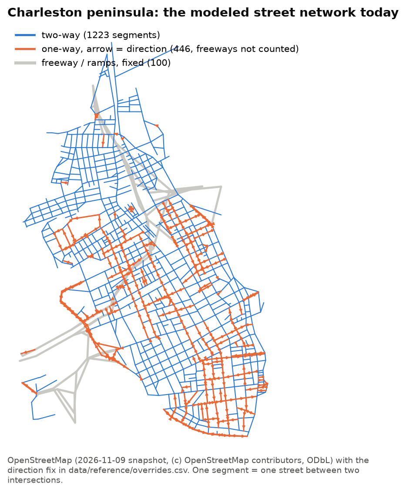
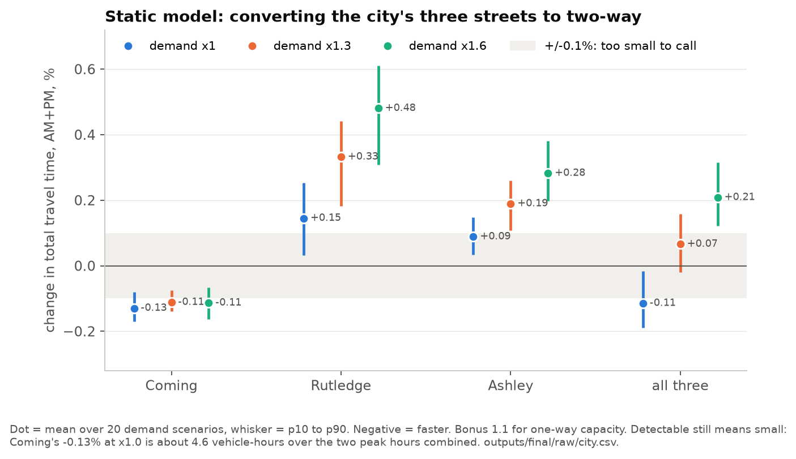
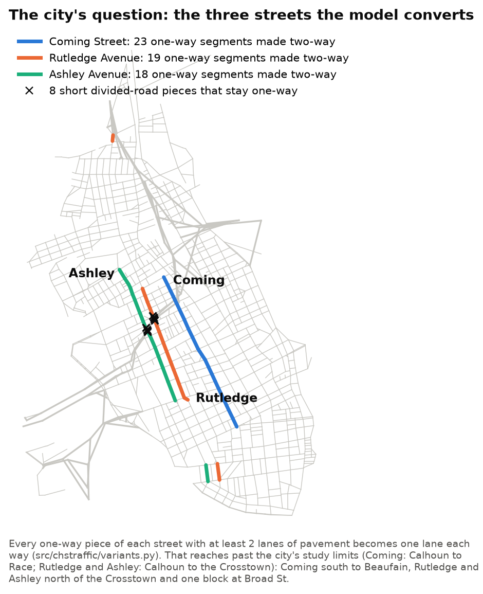
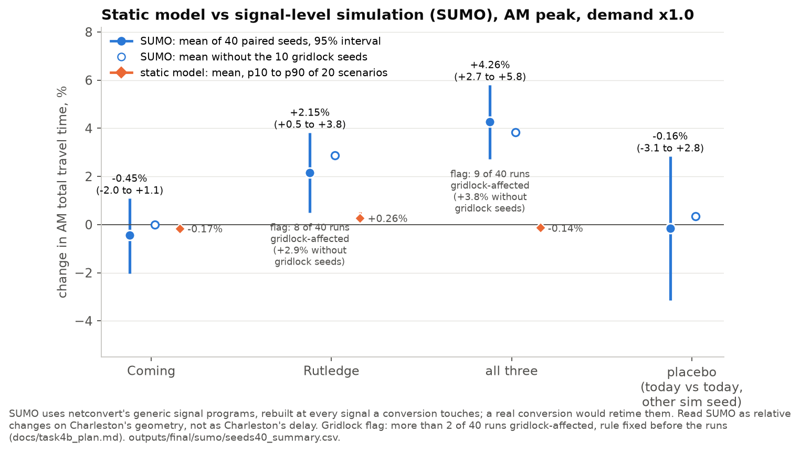
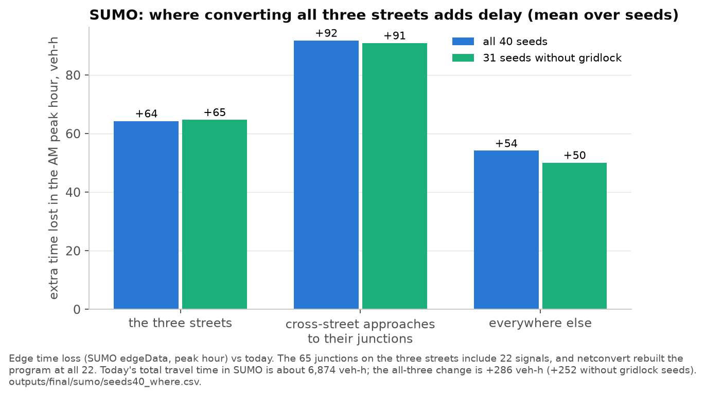
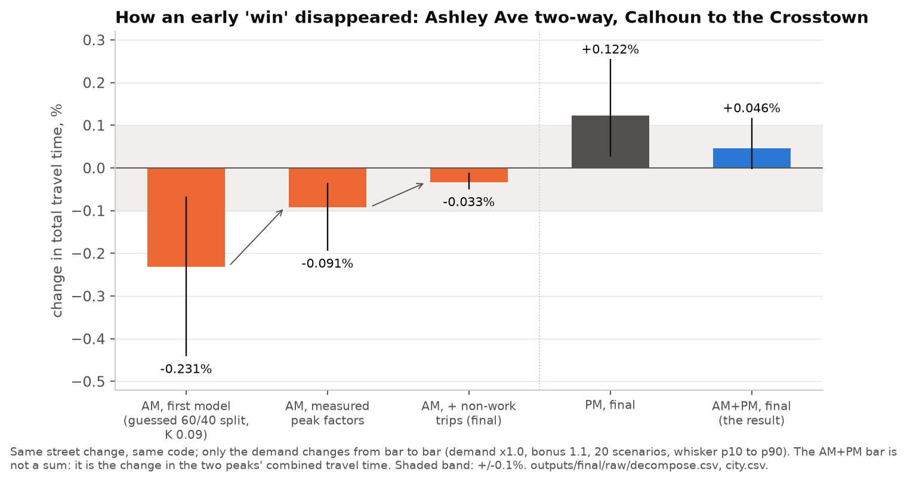
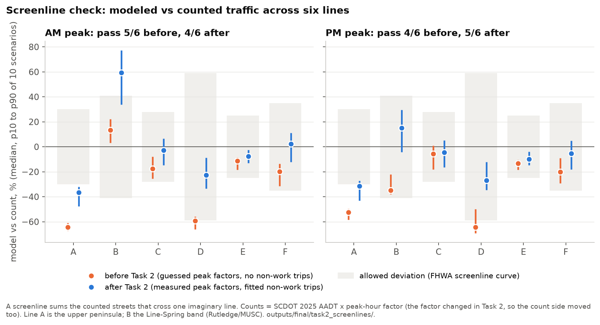

# chs-traffic

**Would making Coming, Rutledge or Ashley two-way change how long it takes to drive around downtown Charleston?**

I modeled every drivable street on the Charleston peninsula as a weighted directed graph, loaded it with
peak-hour traffic built from public counts and census commute data, and compared one-way and two-way
layouts of the same pavement. The short answer: no conversion I tested makes driving meaningfully
faster. In a static traffic model the city's three candidate streets barely matter either way (the best,
Coming St, saves 0.13%); in a signal-level simulation with generic signal timing, converting all three
makes the morning peak about 4% slower, though 9 of its 40 simulation runs hit the gridlock flag I set in
advance (the result still holds without them). The caveats on both are spelled out below.

Created by **Bhrett Boggs**. MIT License.

## 1. The question, and why Charleston

Charleston has spent about 30 years undoing its one-way street pairs: Upper King St went back to two-way
in 1994, Spring and Cannon in 2017, and Line St and several shorter pieces along the way. In 2025 the
city paid for a feasibility study (about $230,000, Kimley-Horn) of converting three more: **Coming St** (Calhoun to Race), and **Rutledge
and Ashley Aves** (Calhoun to the Crosstown). The city's reasons are safety and livability, not traffic
speed. The question I can put a number on is the traffic side: what does each conversion do to the total
time everyone spends driving in the peak hour? I also let a search try every other one-way/two-way
change on 46 main corridors to see whether any layout of the same pavement does better than today's.

## 2. Method in five steps

1. **Network.** OpenStreetMap streets on the peninsula (1,141 intersections, 2,991 directed links),
   with one-way directions checked against the county street layer (on the main corridors OSM was right
   in 35 of 37 disagreements with a verdict; the other 2, on Beaufain St, were fixed).
   Lanes come from OSM, with 16 overrides from city curb widths.
2. **Traffic from outside.** Six gateways (I-26, the Ravenel Bridge, the Ashley River bridges, the James
   Island Expressway, Meeting St, King St Ext) sized from SCDOT 2025 counts, with peak-hour factors and
   inbound/outbound splits measured from SCDOT hourly counts (Sept-Oct 2025) for the AM and PM peaks.
3. **Traffic inside.** 90 zones built from Census LODES 2024 (where peninsula jobs and workers are, and
   who commutes where), plus non-work trips fitted once on half the count stations and checked on the
   other half.
4. **Static user equilibrium.** Every driver takes the fastest route given everyone else's choices
   (Frank-Wolfe, BPR link delay). Each layout is solved for 20 random demand scenarios, in the AM and PM
   peaks, at three demand levels (x1.0, x1.3, x1.6). A change counts as detectable only if the mean is
   bigger than 0.1% of total travel time **and** has the same sign in at least 80% of the scenarios.
5. **SUMO check.** The same street network and trips in SUMO, a traffic simulator that models signals and
   queues at intersections, with a plan written before the runs (`docs/task4b_plan.md`): AM peak, 40
   paired seeds, a placebo, and a rule that flags a variant as unreliable if more than 2 of its 40 runs
   gridlock.

## 3. Results

### Static model

* **Coming St two-way: -0.13%** (p10 to p90 of 20 scenarios: -0.17% to -0.08%), better in every scenario,
  and still detectable at x1.3 and x1.6. That is about 4.6 vehicle-hours over the two peak hours combined,
  out of about 3,600. Detectable, but tiny: the fair reading is *no measurable cost to drivers*, not
  *improves traffic*.
* **Rutledge Ave two-way: +0.15% worse** (+0.03% to +0.25%), and more so at higher demand.
* **Ashley Ave, and all three together, depend on the demand level.** Ashley is +0.09% at x1.0 (not
  detectable) and detectably worse at x1.3 and x1.6. All three together are -0.11% at x1.0, not
  detectable at x1.3, and +0.21% worse at x1.6.
* **The open search accepted nothing.** 86 single moves on 46 corridors were screened at each demand
  level; none beat today's network by 0.1%.

One thing to know when comparing with the city's study: the model converts every remaining one-way piece
of each street, which reaches past the city's study limits (Coming south to Beaufain; Rutledge and Ashley
north of the Crosstown and one block at Broad St). The Ashley piece that matches the city's limits
(Calhoun to the Crosstown) is in section 4.

### Signal-level simulation (SUMO): the headline changes

AM peak, demand x1.0, 40 paired seeds, generic signal programs (mean, 95% interval over seeds):

* **All three two-way: +4.3% (95% interval +2.7% to +5.8%), worse in 34 of 40 seeds**, where the static
  model said -0.14% for the same AM peak. Flag: this variant failed the pre-registered gridlock rule (9 of
  40 runs gridlock-affected); without the gridlock seeds it is still +3.8% (+1.9% to +5.7%).
* **Rutledge two-way: +2.2% (+0.5% to +3.8%)**, the same sign as the static model's +0.26% for the AM
  peak but about 8 times larger. Flag: this variant also failed the gridlock rule (8 of 40 runs); without
  the gridlock seeds it is +2.9% (+0.9% to +4.9%).
* **Coming two-way: -0.45% (-2.0% to +1.1%): unresolved.** None of its 40 runs gridlocked. SUMO can't
  tell this apart from zero, so Coming's static -0.13% stays a static-model-only result.
* **Placebo** (today against itself with a different simulation seed): -0.16% (-3.1% to +2.8%), centred on
  zero, so the pairing works.

Where the all-three penalty sits (extra time lost in the AM peak hour, mean of all 40 seeds; 31 seeds
without gridlock in brackets): +64 veh-h (+65) on the three streets themselves, **+92 veh-h (+91) on the
cross-street approaches** to their 65 junctions, and +54 veh-h (+50) everywhere else. Those junctions include
22 signals, and SUMO rebuilt its default signal program at all 22. So about three quarters of the extra
delay is on the converted streets and the cross streets waiting at their junctions, where two-way traffic
now shares signal time with the cross traffic: exactly what a static model with no intersection delay
can't see. For Rutledge alone the extra delay is mostly elsewhere in the
network (I-26 entrants and internal trips): a capacity and rerouting effect of going from two lanes one
way to one lane each way.

## 4. How I tried not to fool myself

**The Ashley reversal.** An early version of the model found one layout change worth making: Ashley Ave
two-way between Calhoun and the Crosstown, -0.23% in the AM peak. It did not survive better demand data.

Same street change, same code, only the demand changed: the first model guessed a 60/40 inbound/outbound
split for the morning; measured SCDOT hourly counts put it at 51-56% inbound, and the effect shrank from
-0.23% to -0.09%. Adding non-work trips took it to -0.03%. The PM peak, which the first model didn't have,
is +0.12%, so the two peaks together come to +0.05%: nothing. The guessed split had exaggerated every
directional effect in the model, not just this one.

**Static vs SUMO.** The static model can't see intersection delay at all. With 5 seeds, SUMO's run-to-run
noise (about 3.5% of total travel time) was far bigger than the static effects, so I wrote down the test
before running it: 40 seeds sharing the same trips across layouts, a placebo to show the pairing worked,
a detection rule and a gridlock rule. That test found what the static model structurally misses, and it
flipped the sign for all three streets together.

## 5. Validation

* **Screenlines** (total counted traffic across six imaginary lines, against FHWA's allowed deviation):
  4 of 6 pass in the AM and 5 of 6 in the PM after the demand work (5 and 4 before). Line A, the upper
  peninsula, is still 31-37% short, and line B (the Rutledge/MUSC band) is 59% over in the AM.
* **Link level is not achieved, and I don't claim it.** Only 17-22% of the held-out count stations reach
  GEH < 5 (the usual target is 85%). The model gets totals across a line roughly right more often than it
  gets which parallel street carries them.
* **Back-test on Spring and Cannon** (two-way since 2017): the model says the conversion cut total travel
  time by 0.16%, which is plausible. But it gets the volume change on Spring St wrong in sign: +37% in
  the model, -7% to -25% in SCDOT counts after 2017 (Cannon: -13% in the model, 0% to +7% counted). The
  2017 project was more than a direction change: it added new curbs, sidewalks, street lighting, trees,
  traffic signals and pedestrian crossing signals, a required right turn for eastbound Spring at Meeting,
  and changed turning movements at Cannon and King
  ([City of Charleston, 2017-09-20](https://www.charleston-sc.gov/Archive.aspx?ADID=388);
  [Charleston City Paper, 2017-09-21](https://charlestoncitypaper.com/2017/09/21/two-way-conversion-of-spring-and-cannon-streets-begins-oct-2/)).
  A model with fixed speeds and capacities per lane can't represent any of that, so its street-level
  volume shifts are not evidence of anything.

## 6. What this does not show

* **The static model has no intersection delay.** No signals, queues, turns or pedestrians. It runs at
  1.02x free-flow time in the AM and only reaches 1.07-1.09x at 60% more demand. Its effects are
  link-level only.
* **SUMO's signals are generic.** SUMO uses netconvert's default signal programs and rebuilds them at
  every signal a conversion touches (22 for all three). A real conversion would come with retimed signals
  and possibly turn lanes. Part of SUMO's penalty may come from the generic programs; I did not measure how
  much. SUMO numbers are relative changes on Charleston's street geometry, not Charleston's real delay.
* **SUMO results are AM only.** The PM gridlocked at full demand and needed demand x0.8; the PM was not
  rerun with 40 seeds.
* **Demand x1.0 is marginal in SUMO:** 3 of 40 runs of today's network are gridlock-affected too.
* **40 paired seeds still resolve only effects of about 1.5% or more**, so Coming is unresolved, and
  Ashley alone was not run.
* **Demand is modeled, not observed.** Gateways come from counts; where trips go comes from LODES commute
  data and a fitted non-work share. Students and visitors are not in the commute data.
* Other weak points: lane capacities are class defaults, the 10% one-way capacity bonus is a guess
  (results checked at 0%, 10% and 20%), and the model's "Coming/Rutledge/Ashley" is longer than the city's
  study area.
* **Nothing here optimizes or improves Charleston's traffic.** These are comparisons between layouts on
  the same model.

## 7. The city's 2025 study

As of 2026-11-13 the city has published no findings or recommendations. The project page has the boards
from the first public meeting (2025-09-04): existing conditions, a 2045 no-build analysis still under
way, crash data and on-street parking counts (57 spaces on Ashley, 129 on Rutledge, 115 on Coming), with a
build analysis, a second public meeting and a City Council presentation still to come
([city project page](https://charleston-sc.gov/3132/NEW-Feasibility-Study-for-Two-Way-Traffi);
[meeting boards](https://charleston-sc.gov/DocumentCenter/View/39497)). So there is nothing to compare
yet. When it is published, the comparable numbers will be its intersection delay and level of service,
which is what SUMO approximates here, not the static model.

## Reproduce

Windows Command Prompt, Python 3.11:

    py -3.11 -m pip install --user -r requirements.txt
    scripts\run_final.cmd
    py -3.11 scripts\15_make_figures.py

`run_final.cmd` rebuilds the graph and every static result in `outputs\final\` (1.5 to 3 hours, resumable);
`15_make_figures.py` redraws `docs\figures\` from those files in a few seconds. The OSM snapshot from
2026-11-09 is in `data/raw`; `scripts\01_fetch_osm.py` refetches it (results will then differ slightly).

The Census LODES files (17.5 MB) are not in git; `data/raw/README.md` lists the URLs and checksums for
them and every other input. The zone tables built from them are in `data/reference/`, so `run_final.cmd`
runs without them. The SUMO results need `py -3.11 -m pip install --user -r requirements-sumo.txt`, then
`py -3.11 scripts\14_sumo_check.py nets` and `py -3.11 scripts\16_sumo_seeds.py main --workers N` (the 200 runs took about
4 hours on an 8-core laptop). Tests: `py -3.11 -m pytest`. On Linux/macOS use `python` and forward slashes.

Full tables: [`docs/RESULTS.md`](docs/RESULTS.md). Where every number in this README comes from:
[`docs/CLAIMS.md`](docs/CLAIMS.md).

## Data credits

* Street network: © OpenStreetMap contributors, licensed under the
  [Open Database License (ODbL)](https://opendatacommons.org/licenses/odbl/).
* Traffic counts: South Carolina Department of Transportation (SCDOT), 2025 Average Daily Traffic and
  continuous-count hourly data.
* Jobs, workers and commutes: U.S. Census Bureau, LEHD Origin-Destination Employment Statistics
  (LODES 8.5, 2024).
* Street centerlines, one-way attributes and pavement widths: City of Charleston and Charleston County GIS.
