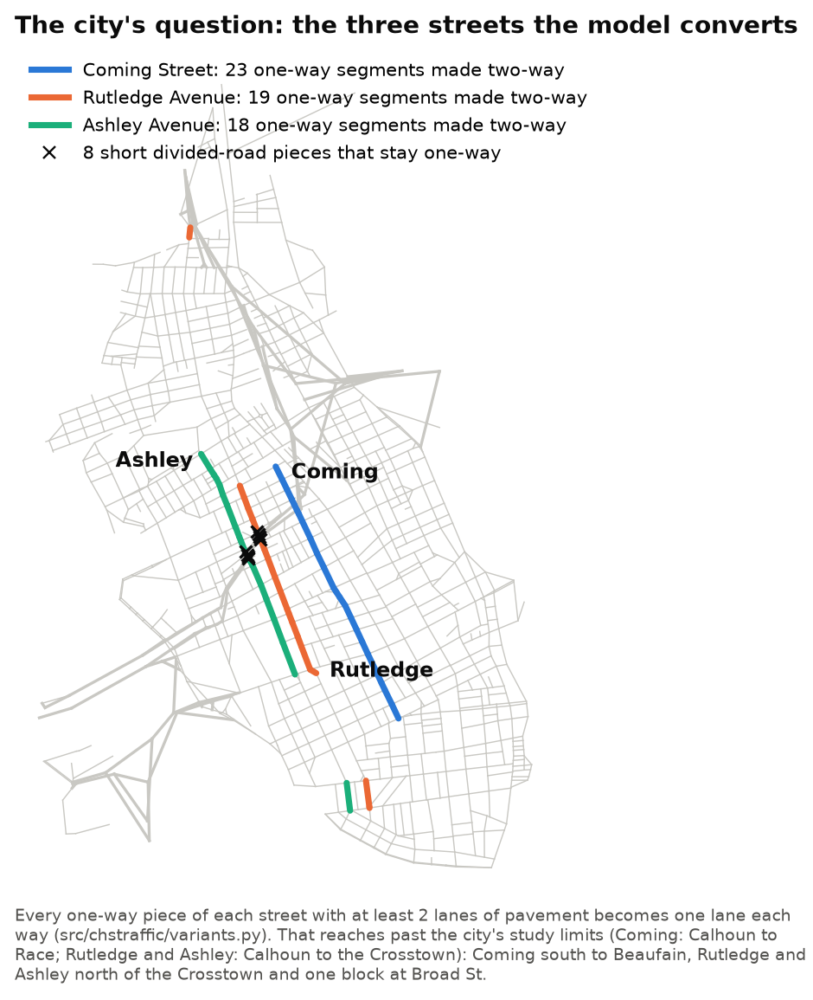
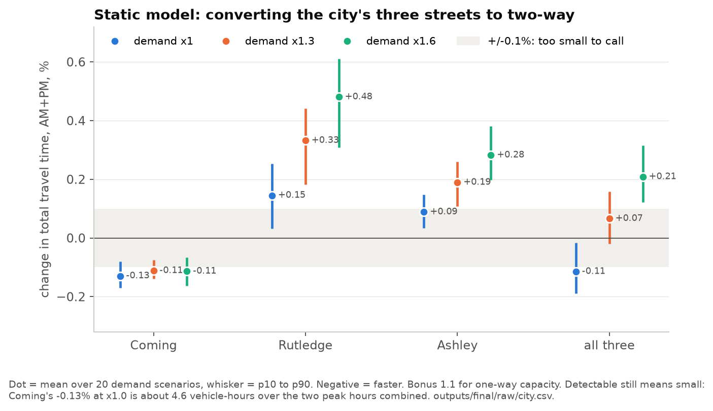
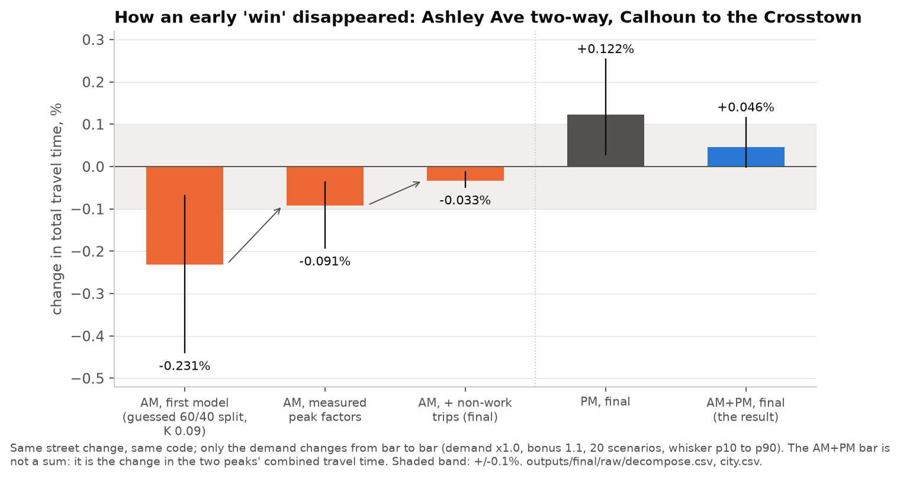
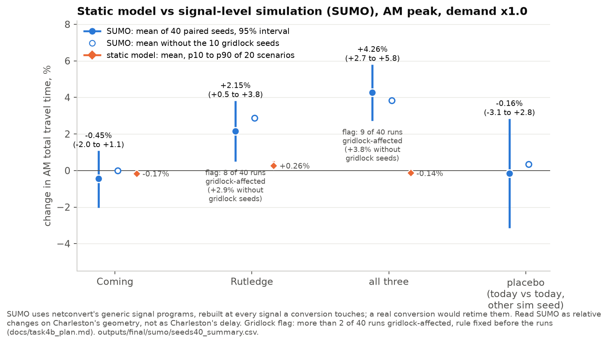
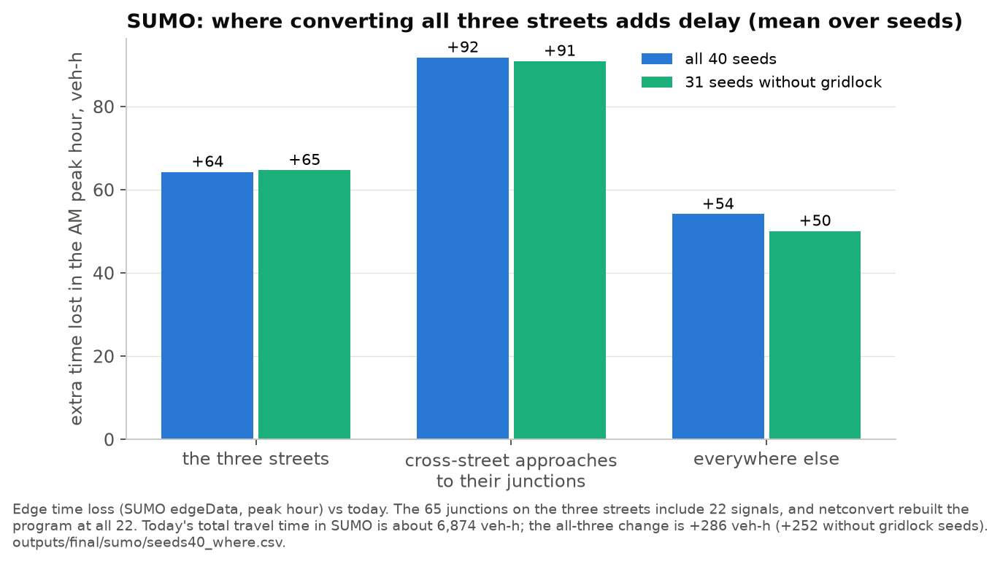

# Results, the long version

This is the full record behind the [README](../README.md): every table, with where it comes from. All
numbers are copied from the frozen result files in `outputs/final/` (static model) and
`outputs/final/sumo/` (SUMO); none were rerun for this write-up. Figures: `scripts/15_make_figures.py`.

Contents: [1 Setup](#1-setup) · [2 Inputs and validation](#2-inputs-and-validation) ·
[3 Static results](#3-static-results) · [4 The Ashley reversal](#4-the-ashley-reversal) ·
[5 Open search](#5-open-search) · [6 SUMO](#6-sumo) · [7 The city's 2025 study](#7-the-citys-2025-study) ·
[8 What this does not show](#8-what-this-does-not-show)

## 1. Setup

The project ran in phases, and some tables name them: **Task 1** checked the network's one-way directions,
**Task 2** replaced guessed demand factors with measured ones and fitted non-work trips, **Task 3** produced
the final static results, **Task 4/4b** were the SUMO checks (5 seeds, then 40).

* **Network:** OpenStreetMap, 2026-11-09 snapshot, peninsula bounding box. 1,141 nodes, 2,991 directed
  edges, 1,769 street segments (one segment = one street between two intersections; 100 freeway/ramp
  segments are frozen). 118 nodes carry an OSM traffic signal (used only by SUMO).
* **Demand:** six gateways sized from SCDOT 2025 AADT x a measured peak-hour factor and inbound split;
  through traffic between gateways; 90 zones from Census LODES 2024 (jobs, resident workers, internal
  commutes); 4,500 vph of internal non-work trips (fitted). Base AM demand 28,696 vph, PM 30,040 vph.
* **Static assignment:** user equilibrium, conjugate Frank-Wolfe, BPR link delay (0.15, 4), relative gap
  1e-4. Capacities by road class; one-way streets get a 10% capacity bonus (also run at 0% and 20%).
  A two-way conversion splits the existing lanes (a 2-lane one-way street becomes 1 + 1).
* **Scenarios:** 20 demand scenarios (gateway volumes +/-20%, zone weights lognormal, distance decay,
  internal volume x0.5 to x1.5), AM and PM peak, all demand x1.0, x1.3 and x1.6. AM+PM adds the two peaks
  of the same scenario.
* **Change** = TSTT(new) / TSTT(today) - 1 per scenario (TSTT = total travel time of all vehicles in the
  peak hour). **Detectable** = |mean| > 0.1% and the same sign in at least 80% of scenarios.
* **Noise floor:** the same network solved twice differs by at most 0.015% per scenario (edge order
  shuffled) and 0.043% (gap 1e-4 vs 1e-5). The 0.1% threshold is about 10 times that; it works as a
  practical-size threshold, not a noise limit.

<!-- copied from outputs/final/RESULTS.md, section '1. Noise floor' -->

Largest per-scenario difference between two solves of the same network at gap 0.0001 (edge order shuffled): **0.0145%**; largest difference between gap 0.0001 and 1e-05: **0.0429%**. Detection threshold used below: **0.10%** (config.MIN_MEAN_IMPROVEMENT), and a result also needs the same sign in at least 80% of scenarios.

| demand | peak | compare | n | median_abs | p95_abs | max_abs | iterations |
|---|---|---|---|---|---|---|---|
| 1 | am | shuffle1 vs canonical | 20 | +0.000% | +0.002% | +0.004% | 17 |
| 1 | am | shuffle2 vs canonical | 20 | +0.000% | +0.002% | +0.003% | 17 |
| 1 | am | tight vs canonical | 20 | +0.004% | +0.010% | +0.014% | 54 |
| 1 | pm | shuffle1 vs canonical | 20 | +0.000% | +0.000% | +0.005% | 19 |
| 1 | pm | shuffle2 vs canonical | 20 | +0.000% | +0.010% | +0.014% | 19 |
| 1 | pm | tight vs canonical | 20 | +0.009% | +0.025% | +0.030% | 51 |
| 1.3 | am | shuffle1 vs canonical | 20 | +0.000% | +0.003% | +0.006% | 31 |
| 1.3 | am | shuffle2 vs canonical | 20 | +0.000% | +0.007% | +0.011% | 31 |
| 1.3 | am | tight vs canonical | 20 | +0.006% | +0.019% | +0.022% | 120 |
| 1.3 | pm | shuffle1 vs canonical | 20 | +0.000% | +0.001% | +0.014% | 38 |
| 1.3 | pm | shuffle2 vs canonical | 20 | +0.000% | +0.003% | +0.003% | 38 |
| 1.3 | pm | tight vs canonical | 20 | +0.007% | +0.024% | +0.043% | 141 |
| 1.6 | am | shuffle1 vs canonical | 20 | +0.000% | +0.006% | +0.008% | 42 |
| 1.6 | am | shuffle2 vs canonical | 20 | +0.000% | +0.006% | +0.008% | 42 |
| 1.6 | am | tight vs canonical | 20 | +0.007% | +0.020% | +0.020% | 163 |
| 1.6 | pm | shuffle1 vs canonical | 20 | +0.000% | +0.000% | +0.005% | 56 |
| 1.6 | pm | shuffle2 vs canonical | 20 | +0.000% | +0.000% | +0.005% | 56 |
| 1.6 | pm | tight vs canonical | 20 | +0.007% | +0.016% | +0.020% | 278 |
| 1 | am+pm | shuffle1 vs canonical | 20 | +0.000% | +0.002% | +0.003% |  |
| 1 | am+pm | shuffle2 vs canonical | 20 | +0.000% | +0.005% | +0.007% |  |
| 1 | am+pm | tight vs canonical | 20 | +0.002% | +0.013% | +0.016% |  |
| 1.3 | am+pm | shuffle1 vs canonical | 20 | +0.000% | +0.002% | +0.010% |  |
| 1.3 | am+pm | shuffle2 vs canonical | 20 | +0.000% | +0.003% | +0.004% |  |
| 1.3 | am+pm | tight vs canonical | 20 | +0.006% | +0.015% | +0.021% |  |
| 1.6 | am+pm | shuffle1 vs canonical | 20 | +0.000% | +0.003% | +0.003% |  |
| 1.6 | am+pm | shuffle2 vs canonical | 20 | +0.000% | +0.001% | +0.003% |  |
| 1.6 | am+pm | tight vs canonical | 20 | +0.007% | +0.013% | +0.013% |  |

## 2. Inputs and validation

### 2.1 One-way directions (network check)

OSM directions were compared with the Charleston County street layer segment by segment: 1,501 segments
compared after setting aside divided-road drawing differences, 1,391 agree. The 42 disagreements on the 46
search corridors were reviewed one by one (`data/reference/oneway_review.csv`): OSM right 35 times
(Spring and Cannon, converted 2017; Upper King, two-way since 1994; Ashley Wentworth-Halsey; and others),
2 fixed (Beaufain St, St. Philip to Market, one-way to two-way), 5 unknown. The county layer still shows
Spring, Cannon, Upper King and Line St as one-way. The Beaufain fix moves the baseline by -0.005%, and all
5 unknowns together by at most +0.035% each.

### 2.2 Peak-hour factors (measured)

SCDOT continuous-count stations, Tuesday-Thursday, 2025-09-02 to 2025-10-30 (median over days, p10-p90
across days in brackets). Network peak hour: AM 8-9, PM 5-6. Gateways without a station take the
AADT-weighted mean (an assumption, marked). Source: `data/reference/peak_factors.csv`
(`scripts/11_peak_factors.py`).

| Gateway | AM K | AM inbound split | PM K | PM inbound split | Source |
|---|---|---|---|---|---|
| I-26 (station 0031) | 0.068 (0.061-0.073) | 0.558 (0.519-0.589) | 0.073 (0.065-0.079) | 0.487 (0.456-0.516) | measured |
| Ravenel Bridge (0006 + 0007) | 0.090 (0.086-0.093) | 0.507 (0.494-0.523) | 0.093 (0.086-0.096) | 0.511 (0.496-0.529) | measured |
| Ashley River bridges (0040) | 0.069 (0.065-0.071) | 0.523 (0.500-0.549) | 0.073 (0.069-0.077) | 0.466 (0.433-0.489) | measured |
| James Island Expressway | 0.077 (0.072-0.081) | 0.531 (0.506-0.555) | 0.082 (0.074-0.085) | 0.494 (0.469-0.517) | no station: mean of the stations (assumption) |
| Meeting St | 0.077 (0.072-0.081) | 0.531 (0.506-0.555) | 0.082 (0.074-0.085) | 0.494 (0.469-0.517) | no station: mean of the stations (assumption) |
| King St Ext | 0.077 (0.072-0.081) | 0.531 (0.506-0.555) | 0.082 (0.074-0.085) | 0.494 (0.469-0.517) | no station: mean of the stations (assumption) |
| interior count stations | 0.077 (0.072-0.081) | 0.531 (0.506-0.555) | 0.082 (0.074-0.085) | 0.494 (0.469-0.517) | no station: mean of the stations (assumption) |

The first model guessed K = 0.09 and a 60/40 inbound split in the AM. Measured, every gateway is 51-56%
inbound in the AM and 47-51% in the PM, and K is lower than 0.09 everywhere except the Ravenel Bridge.

### 2.3 Screenlines

A screenline sums the counted streets crossing one imaginary line, so the model is judged on the total and
not on which of several parallel streets it picked. Count = SCDOT 2025 AADT x the peak factor; tolerance
= FHWA maximum desirable deviation for the line's volume. Model = median of 10 scenarios (p10-p90).
Files: `outputs/final/task2_screenlines/` (output of `scripts/04_calibrate.py --peak both`, 2026-11-12;
"before" = guessed factors and no non-work trips, "measured" = measured factors and no non-work trips,
"final" = the model used for every result).

**AM peak**

| Line | Name | Tolerance | Before | Measured factors | Final: count vph | Final: model vph (p10-p90) | Final deviation |
|---|---|---|---|---|---|---|---|
| A | Upper peninsula (Race St to Mount Pleasant St) | ±30% | -64% ✗ | -59% ✗ | 4,778 | 3,033 (2,497-3,252) | **-37% ✗** |
| B | Line St to Spring St band | ±41% | +13% | +18% | 2,204 | 3,513 (2,952-3,909) | **+59% ✗** |
| C | Calhoun St to Cannon St band | ±28% | -18% | -18% | 6,046 | 5,886 (5,163-6,441) | **-3%** |
| D | South of Calhoun St | ±59% | -59% | -56% | 811 | 628 (541-741) | **-23%** |
| E | West side (Lockwood Dr to Rutledge Ave) | ±25% | -11% | -13% | 9,798 | 9,051 (8,515-9,544) | **-8%** |
| F | Middle (Rutledge Ave to Meeting St) | ±35% | -20% | -19% | 3,042 | 3,109 (2,672-3,377) | **+2%** |
| | pass | | 5/6 | 5/6 | | | **4/6** |

**PM peak**

| Line | Name | Tolerance | Before | Measured factors | Final: count vph | Final: model vph (p10-p90) | Final deviation |
|---|---|---|---|---|---|---|---|
| A | Upper peninsula (Race St to Mount Pleasant St) | ±30% | -53% ✗ | -51% ✗ | 5,052 | 3,461 (2,877-3,674) | **-31% ✗** |
| B | Line St to Spring St band | ±41% | -35% | -41% ✗ | 2,329 | 2,681 (2,233-3,016) | **+15%** |
| C | Calhoun St to Cannon St band | ±28% | -6% | -15% | 6,389 | 6,099 (5,349-6,713) | **-5%** |
| D | South of Calhoun St | ±59% | -64% ✗ | -60% ✗ | 857 | 627 (561-754) | **-27%** |
| E | West side (Lockwood Dr to Rutledge Ave) | ±25% | -13% | -15% | 10,356 | 9,342 (8,826-9,956) | **-10%** |
| F | Middle (Rutledge Ave to Meeting St) | ±35% | -20% | -27% | 3,215 | 3,045 (2,637-3,372) | **-5%** |
| | pass | | 4/6 | 3/6 | | | **5/6** |

✗ = outside the tolerance. The count column changes between states because the peak factor changed (before: K 0.09).

Read it skeptically: the tolerances are wide planning-model guidance; line E passes largely because the
Crosstown is most of it; line A (upper peninsula) fails in both peaks; and the non-work fit moved traffic
between lines (B got worse), not only added it.

### 2.4 Link level (not achieved)

Middle-segment flow at 37 SCDOT stations (19 used for fitting, 18 held out), final model:

| Peak | Half | GEH < 5 | median GEH | model/count total |
|---|---|---|---|---|
| AM | calibrate (19) | 32% | 9.4 | 1.08 |
| AM | held out (18) | 22% | 15.4 | 0.72 |
| PM | calibrate (19) | 32% | 6.6 | 1.03 |
| PM | held out (18) | 17% | 16.9 | 0.71 |

The usual target is GEH < 5 at 85% of stations. Link-level calibration is not achieved and is not claimed.

### 2.5 Congestion level

TSTT divided by free-flow travel time of the same flows (10 scenarios, median): AM 1.019 (p10-p90
1.015-1.024), PM 1.025 (1.020-1.029). At demand x1.3: AM 1.039, PM 1.050; at x1.6: AM 1.073, PM 1.089. With
screenline totals within 5-10% of the counts, the static model still runs barely above free flow. The
likeliest cause (judgment, about 75%) is on the supply side: no signal or intersection delay, class-default
capacities and BPR delay on links only. This is why every static result is shown at three demand levels,
and why the SUMO check exists.

### 2.6 Back-test: Spring and Cannon (two-way since October 2017)

"Before" = today's two-way pieces of Spring made one-way westbound and of Cannon one-way eastbound.

<!-- copied from outputs/final/RESULTS.md, section '2. Back-test: Spring/Cannon two-way (today) vs one-way (2016)' -->

| bonus | demand | peak | n | mean | p10 | median | p90 | improved_share | vkm_mean | verdict |
|---|---|---|---|---|---|---|---|---|---|---|
| 1.1 | 1 | am | 20 | -0.154% | -0.179% | -0.158% | -0.134% | 100% | -0.099% | detectable: better |
| 1.1 | 1 | pm | 20 | -0.157% | -0.188% | -0.158% | -0.116% | 100% | -0.109% | detectable: better |
| 1.1 | 1 | am+pm | 20 | -0.156% | -0.172% | -0.159% | -0.122% | 100% | -0.104% | detectable: better |
| 1.1 | 1.3 | am | 20 | -0.137% | -0.160% | -0.140% | -0.115% | 100% | -0.093% | detectable: better |
| 1.1 | 1.3 | pm | 20 | -0.122% | -0.146% | -0.122% | -0.090% | 100% | -0.116% | detectable: better |
| 1.1 | 1.3 | am+pm | 20 | -0.129% | -0.146% | -0.129% | -0.108% | 100% | -0.105% | detectable: better |
| 1.1 | 1.6 | am | 20 | -0.081% | -0.112% | -0.083% | -0.044% | 95% | -0.101% | not detectable |
| 1.1 | 1.6 | pm | 20 | -0.028% | -0.087% | -0.027% | +0.037% | 80% | -0.120% | not detectable |
| 1.1 | 1.6 | am+pm | 20 | -0.054% | -0.089% | -0.056% | -0.014% | 95% | -0.111% | not detectable |

Modeled two-way volume at the count stations (both directions, median over scenarios, vph; interior count K 0.077 AM / 0.082 PM):

| demand | config | street | am | pm | am_plus_pm |
|---|---|---|---|---|---|
| 1 | after (today) | spring | 823 | 945 | 1775 |
| 1 | after (today) | cannon | 511 | 442 | 965 |
| 1 | before (2016) | spring | 568 | 723 | 1298 |
| 1 | before (2016) | cannon | 591 | 507 | 1103 |
| 1.3 | after (today) | spring | 1135 | 1247 | 2373 |
| 1.3 | after (today) | cannon | 688 | 648 | 1333 |
| 1.3 | before (2016) | spring | 836 | 1035 | 1884 |
| 1.3 | before (2016) | cannon | 887 | 751 | 1639 |
| 1.6 | after (today) | spring | 1375 | 1490 | 2881 |
| 1.6 | after (today) | cannon | 844 | 968 | 1834 |
| 1.6 | before (2016) | spring | 1195 | 1443 | 2664 |
| 1.6 | before (2016) | cannon | 1115 | 1021 | 2136 |

Modeled change vs observed SCDOT AADT change (conversion late 2017):

| demand | street | am_change | pm_change | am_plus_pm_change | observed_2016_to_2018 | observed_2016_to_2019 | observed_2016_to_2025 | sign_matches_all_years |
|---|---|---|---|---|---|---|---|---|
| 1 | cannon | -13.559% | -12.828% | -12.552% | +1.754% | +7.018% | +0.000% | False |
| 1 | spring | +44.865% | +30.745% | +36.783% | -7.463% | -25.373% | -16.418% | False |
| 1.3 | cannon | -22.370% | -13.731% | -18.668% | +1.754% | +7.018% | +0.000% | False |
| 1.3 | spring | +35.863% | +20.491% | +25.967% | -7.463% | -25.373% | -16.418% | False |
| 1.6 | cannon | -24.294% | -5.184% | -14.143% | +1.754% | +7.018% | +0.000% | False |
| 1.6 | spring | +15.078% | +3.235% | +8.157% | -7.463% | -25.373% | -16.418% | False |

**Travel time:** the conversion lowers TSTT by 0.16% at x1.0 (detectable), plausible and not alarming.
**Volume:** wrong sign on Spring at every demand level. The 2017 project also brought new curbs, sidewalks,
street lighting, trees, traffic signals and pedestrian crossing signals, a required right turn for
eastbound Spring at Meeting and changed turning movements at Cannon and King
([City of Charleston release, 2017-09-20](https://www.charleston-sc.gov/Archive.aspx?ADID=388);
[Charleston City Paper, 2017-09-21](https://charlestoncitypaper.com/2017/09/21/two-way-conversion-of-spring-and-cannon-streets-begins-oct-2/)).
A model with fixed speeds and capacities per lane represents none of that. Also, the model already puts
1.9 times the counted AM traffic on Spring today (823 vs 431 vph), so it is a poor street to read a change
on. The model's street-level volume shifts are not evidence of anything.

## 3. Static results

### 3.1 The three streets as modeled

| Variant | One-way segments made two-way | Length | Beyond the city's study limits (approx.) |
|---|---|---|---|
| Coming St | 23 | 2.23 km | Calhoun to Beaufain, 5 segments, ~0.57 km |
| Rutledge Ave | 19 | 1.82 km | north of the Crosstown to Race St, one block at Heriot St, Broad to Tradd: ~0.6 km |
| Ashley Ave | 18 | 2.05 km | north of the Crosstown to Huger St, Broad to Tradd: ~0.9 km |
| all three | 60 | 6.11 km | |

The city's study covers Coming from Calhoun to Race and Rutledge and Ashley from Calhoun to the Crosstown.
The model converts every remaining one-way piece of each street with at least 2 lanes of pavement
(`src/chstraffic/variants.py`), so its variants are longer. 8 short divided-road pieces (9 to 42 m) on
Rutledge and Ashley stay one-way (`outputs/final/city_blocked_segments.csv`). The "Ashley Calhoun-Crosstown"
row below is the piece that matches the city's Ashley limits. Every Coming segment is 2 lanes one-way today
and becomes 1 + 1 (capacity per direction 1,540 to 700 vph).

### 3.2 City question

Change in TSTT, mean (p10 to p90) over 20 scenarios, share of scenarios better, verdict. Bonus = one-way
capacity bonus (1.1 is the main setting).

<!-- copied from outputs/final/RESULTS.md, section '3. City question (two-way conversions) and the first model's Ashley move' -->

| variant | segments_converted |
|---|---|
| Coming Street | 23 |
| Rutledge Avenue | 19 |
| Ashley Avenue | 18 |
| all three | 60 |

8 one-way segment(s) on these streets cannot go two-way (1 lane or frozen): `city_blocked_segments.csv`.

**AM+PM**

| config | bonus | demand | mean | p10 | median | p90 | improved_share | vkm_mean | verdict |
|---|---|---|---|---|---|---|---|---|---|
| Coming Street | 1 | 1 | -0.138% | -0.178% | -0.140% | -0.097% | 100% | -0.170% | detectable: better |
| Rutledge Avenue | 1 | 1 | +0.129% | +0.007% | +0.140% | +0.237% | 10% | -0.082% | detectable: worse |
| Ashley Avenue | 1 | 1 | +0.083% | +0.042% | +0.075% | +0.138% | 0% | -0.026% | not detectable |
| all three | 1 | 1 | -0.132% | -0.202% | -0.139% | -0.039% | 95% | -0.275% | detectable: better |
| Ashley Calhoun-Crosstown | 1 | 1 | +0.043% | +0.000% | +0.036% | +0.102% | 10% | -0.036% | not detectable |
| Coming Street | 1 | 1.3 | -0.135% | -0.177% | -0.140% | -0.091% | 100% | -0.183% | detectable: better |
| Rutledge Avenue | 1 | 1.3 | +0.294% | +0.163% | +0.312% | +0.395% | 0% | -0.078% | detectable: worse |
| Ashley Avenue | 1 | 1.3 | +0.173% | +0.103% | +0.177% | +0.235% | 0% | -0.005% | detectable: worse |
| all three | 1 | 1.3 | -0.005% | -0.074% | -0.001% | +0.071% | 50% | -0.274% | not detectable |
| Ashley Calhoun-Crosstown | 1 | 1.3 | +0.098% | +0.030% | +0.099% | +0.150% | 5% | -0.025% | not detectable |
| Coming Street | 1 | 1.6 | -0.154% | -0.211% | -0.149% | -0.111% | 100% | -0.175% | detectable: better |
| Rutledge Avenue | 1 | 1.6 | +0.395% | +0.212% | +0.442% | +0.538% | 0% | -0.056% | detectable: worse |
| Ashley Avenue | 1 | 1.6 | +0.239% | +0.180% | +0.250% | +0.313% | 0% | +0.021% | detectable: worse |
| all three | 1 | 1.6 | +0.079% | +0.005% | +0.067% | +0.157% | 5% | -0.257% | not detectable |
| Ashley Calhoun-Crosstown | 1 | 1.6 | +0.133% | +0.061% | +0.129% | +0.220% | 5% | -0.010% | detectable: worse |
| Coming Street | 1.1 | 1 | -0.130% | -0.170% | -0.129% | -0.081% | 100% | -0.177% | detectable: better |
| Rutledge Avenue | 1.1 | 1 | +0.145% | +0.033% | +0.161% | +0.253% | 10% | -0.085% | detectable: worse |
| Ashley Avenue | 1.1 | 1 | +0.089% | +0.035% | +0.080% | +0.147% | 0% | -0.028% | not detectable |
| all three | 1.1 | 1 | -0.114% | -0.189% | -0.125% | -0.016% | 90% | -0.280% | detectable: better |
| Ashley Calhoun-Crosstown | 1.1 | 1 | +0.046% | -0.002% | +0.031% | +0.117% | 15% | -0.036% | not detectable |
| Coming Street | 1.1 | 1.3 | -0.112% | -0.140% | -0.112% | -0.074% | 100% | -0.184% | detectable: better |
| Rutledge Avenue | 1.1 | 1.3 | +0.332% | +0.183% | +0.356% | +0.441% | 0% | -0.084% | detectable: worse |
| Ashley Avenue | 1.1 | 1.3 | +0.189% | +0.109% | +0.193% | +0.260% | 0% | -0.007% | detectable: worse |
| all three | 1.1 | 1.3 | +0.066% | -0.020% | +0.062% | +0.158% | 15% | -0.280% | not detectable |
| Ashley Calhoun-Crosstown | 1.1 | 1.3 | +0.112% | +0.027% | +0.114% | +0.193% | 0% | -0.025% | detectable: worse |
| Coming Street | 1.1 | 1.6 | -0.113% | -0.164% | -0.105% | -0.066% | 100% | -0.176% | detectable: better |
| Rutledge Avenue | 1.1 | 1.6 | +0.480% | +0.309% | +0.526% | +0.611% | 0% | -0.057% | detectable: worse |
| Ashley Avenue | 1.1 | 1.6 | +0.282% | +0.197% | +0.294% | +0.382% | 0% | +0.026% | detectable: worse |
| all three | 1.1 | 1.6 | +0.208% | +0.122% | +0.192% | +0.316% | 0% | -0.256% | detectable: worse |
| Ashley Calhoun-Crosstown | 1.1 | 1.6 | +0.170% | +0.078% | +0.167% | +0.271% | 0% | -0.008% | detectable: worse |
| Coming Street | 1.2 | 1 | -0.123% | -0.172% | -0.127% | -0.082% | 100% | -0.178% | detectable: better |
| Rutledge Avenue | 1.2 | 1 | +0.158% | +0.051% | +0.169% | +0.266% | 5% | -0.083% | detectable: worse |
| Ashley Avenue | 1.2 | 1 | +0.097% | +0.039% | +0.079% | +0.171% | 0% | -0.026% | not detectable |
| all three | 1.2 | 1 | -0.098% | -0.180% | -0.106% | +0.014% | 85% | -0.282% | not detectable |
| Ashley Calhoun-Crosstown | 1.2 | 1 | +0.053% | -0.003% | +0.046% | +0.120% | 15% | -0.036% | not detectable |
| Coming Street | 1.2 | 1.3 | -0.088% | -0.117% | -0.094% | -0.047% | 100% | -0.190% | not detectable |
| Rutledge Avenue | 1.2 | 1.3 | +0.357% | +0.192% | +0.381% | +0.470% | 0% | -0.088% | detectable: worse |
| Ashley Avenue | 1.2 | 1.3 | +0.194% | +0.108% | +0.191% | +0.290% | 0% | -0.008% | detectable: worse |
| all three | 1.2 | 1.3 | +0.111% | +0.022% | +0.096% | +0.214% | 5% | -0.285% | detectable: worse |
| Ashley Calhoun-Crosstown | 1.2 | 1.3 | +0.119% | +0.041% | +0.119% | +0.210% | 0% | -0.024% | detectable: worse |
| Coming Street | 1.2 | 1.6 | -0.086% | -0.127% | -0.084% | -0.040% | 100% | -0.177% | not detectable |
| Rutledge Avenue | 1.2 | 1.6 | +0.533% | +0.335% | +0.577% | +0.673% | 0% | -0.058% | detectable: worse |
| Ashley Avenue | 1.2 | 1.6 | +0.310% | +0.194% | +0.304% | +0.401% | 0% | +0.030% | detectable: worse |
| all three | 1.2 | 1.6 | +0.304% | +0.184% | +0.277% | +0.433% | 0% | -0.255% | detectable: worse |
| Ashley Calhoun-Crosstown | 1.2 | 1.6 | +0.191% | +0.075% | +0.192% | +0.295% | 0% | -0.006% | detectable: worse |

**AM**

| config | bonus | demand | mean | p10 | median | p90 | improved_share | vkm_mean | verdict |
|---|---|---|---|---|---|---|---|---|---|
| Coming Street | 1 | 1 | -0.174% | -0.215% | -0.173% | -0.135% | 100% | -0.109% | detectable: better |
| Rutledge Avenue | 1 | 1 | +0.254% | +0.098% | +0.231% | +0.471% | 0% | -0.101% | detectable: worse |
| Ashley Avenue | 1 | 1 | -0.037% | -0.059% | -0.031% | -0.014% | 100% | -0.035% | not detectable |
| all three | 1 | 1 | -0.154% | -0.213% | -0.163% | -0.074% | 100% | -0.224% | detectable: better |
| Ashley Calhoun-Crosstown | 1 | 1 | -0.037% | -0.062% | -0.034% | -0.016% | 95% | -0.036% | not detectable |
| Coming Street | 1 | 1.3 | -0.227% | -0.297% | -0.218% | -0.168% | 100% | -0.146% | detectable: better |
| Rutledge Avenue | 1 | 1.3 | +0.581% | +0.379% | +0.591% | +0.783% | 0% | -0.104% | detectable: worse |
| Ashley Avenue | 1 | 1.3 | -0.074% | -0.182% | -0.057% | -0.003% | 95% | -0.029% | not detectable |
| all three | 1 | 1.3 | -0.040% | -0.098% | -0.041% | +0.017% | 70% | -0.252% | not detectable |
| Ashley Calhoun-Crosstown | 1 | 1.3 | -0.076% | -0.186% | -0.065% | -0.005% | 100% | -0.033% | not detectable |
| Coming Street | 1 | 1.6 | -0.375% | -0.534% | -0.362% | -0.268% | 100% | -0.140% | detectable: better |
| Rutledge Avenue | 1 | 1.6 | +0.931% | +0.658% | +0.952% | +1.269% | 0% | -0.067% | detectable: worse |
| Ashley Avenue | 1 | 1.6 | -0.106% | -0.280% | -0.063% | -0.012% | 90% | -0.024% | detectable: better |
| all three | 1 | 1.6 | -0.051% | -0.127% | -0.042% | -0.000% | 90% | -0.235% | not detectable |
| Ashley Calhoun-Crosstown | 1 | 1.6 | -0.120% | -0.302% | -0.077% | -0.005% | 90% | -0.033% | detectable: better |
| Coming Street | 1.1 | 1 | -0.167% | -0.207% | -0.169% | -0.138% | 100% | -0.113% | detectable: better |
| Rutledge Avenue | 1.1 | 1 | +0.263% | +0.104% | +0.233% | +0.509% | 0% | -0.105% | detectable: worse |
| Ashley Avenue | 1.1 | 1 | -0.032% | -0.050% | -0.028% | -0.008% | 100% | -0.037% | not detectable |
| all three | 1.1 | 1 | -0.143% | -0.226% | -0.162% | -0.051% | 100% | -0.226% | detectable: better |
| Ashley Calhoun-Crosstown | 1.1 | 1 | -0.033% | -0.050% | -0.031% | -0.011% | 100% | -0.036% | not detectable |
| Coming Street | 1.1 | 1.3 | -0.187% | -0.237% | -0.186% | -0.135% | 100% | -0.146% | detectable: better |
| Rutledge Avenue | 1.1 | 1.3 | +0.588% | +0.361% | +0.612% | +0.816% | 0% | -0.109% | detectable: worse |
| Ashley Avenue | 1.1 | 1.3 | -0.047% | -0.158% | -0.028% | +0.003% | 85% | -0.032% | not detectable |
| all three | 1.1 | 1.3 | +0.013% | -0.081% | +0.009% | +0.106% | 45% | -0.255% | not detectable |
| Ashley Calhoun-Crosstown | 1.1 | 1.3 | -0.054% | -0.172% | -0.034% | +0.004% | 85% | -0.036% | not detectable |
| Coming Street | 1.1 | 1.6 | -0.329% | -0.495% | -0.303% | -0.215% | 100% | -0.145% | detectable: better |
| Rutledge Avenue | 1.1 | 1.6 | +0.981% | +0.670% | +0.987% | +1.284% | 0% | -0.078% | detectable: worse |
| Ashley Avenue | 1.1 | 1.6 | -0.094% | -0.237% | -0.071% | +0.030% | 85% | -0.024% | not detectable |
| all three | 1.1 | 1.6 | +0.065% | +0.006% | +0.055% | +0.129% | 5% | -0.245% | not detectable |
| Ashley Calhoun-Crosstown | 1.1 | 1.6 | -0.109% | -0.261% | -0.090% | +0.005% | 85% | -0.031% | detectable: better |
| Coming Street | 1.2 | 1 | -0.158% | -0.204% | -0.160% | -0.119% | 100% | -0.112% | detectable: better |
| Rutledge Avenue | 1.2 | 1 | +0.266% | +0.088% | +0.254% | +0.496% | 0% | -0.105% | detectable: worse |
| Ashley Avenue | 1.2 | 1 | -0.029% | -0.044% | -0.026% | -0.006% | 100% | -0.034% | not detectable |
| all three | 1.2 | 1 | -0.134% | -0.216% | -0.148% | -0.031% | 100% | -0.224% | detectable: better |
| Ashley Calhoun-Crosstown | 1.2 | 1 | -0.031% | -0.049% | -0.029% | -0.007% | 100% | -0.034% | not detectable |
| Coming Street | 1.2 | 1.3 | -0.156% | -0.206% | -0.156% | -0.103% | 100% | -0.153% | detectable: better |
| Rutledge Avenue | 1.2 | 1.3 | +0.594% | +0.361% | +0.600% | +0.818% | 0% | -0.109% | detectable: worse |
| Ashley Avenue | 1.2 | 1.3 | -0.039% | -0.172% | -0.019% | +0.022% | 70% | -0.033% | not detectable |
| all three | 1.2 | 1.3 | +0.039% | -0.060% | +0.040% | +0.129% | 30% | -0.256% | not detectable |
| Ashley Calhoun-Crosstown | 1.2 | 1.3 | -0.043% | -0.173% | -0.024% | +0.011% | 70% | -0.033% | not detectable |
| Coming Street | 1.2 | 1.6 | -0.278% | -0.409% | -0.252% | -0.176% | 100% | -0.144% | detectable: better |
| Rutledge Avenue | 1.2 | 1.6 | +1.003% | +0.691% | +1.017% | +1.329% | 0% | -0.080% | detectable: worse |
| Ashley Avenue | 1.2 | 1.6 | -0.083% | -0.198% | -0.065% | +0.031% | 85% | -0.023% | not detectable |
| all three | 1.2 | 1.6 | +0.155% | +0.073% | +0.158% | +0.238% | 0% | -0.244% | detectable: worse |
| Ashley Calhoun-Crosstown | 1.2 | 1.6 | -0.098% | -0.206% | -0.082% | +0.006% | 85% | -0.030% | not detectable |

**PM**

| config | bonus | demand | mean | p10 | median | p90 | improved_share | vkm_mean | verdict |
|---|---|---|---|---|---|---|---|---|---|
| Coming Street | 1 | 1 | -0.104% | -0.157% | -0.112% | -0.032% | 100% | -0.228% | detectable: better |
| Rutledge Avenue | 1 | 1 | +0.010% | -0.080% | +0.010% | +0.112% | 45% | -0.063% | not detectable |
| Ashley Avenue | 1 | 1 | +0.199% | +0.116% | +0.174% | +0.305% | 0% | -0.017% | detectable: worse |
| all three | 1 | 1 | -0.112% | -0.184% | -0.120% | +0.011% | 85% | -0.324% | detectable: better |
| Ashley Calhoun-Crosstown | 1 | 1 | +0.119% | +0.036% | +0.107% | +0.233% | 0% | -0.035% | detectable: worse |
| Coming Street | 1 | 1.3 | -0.048% | -0.104% | -0.048% | +0.018% | 80% | -0.219% | not detectable |
| Rutledge Avenue | 1 | 1.3 | +0.022% | -0.076% | +0.031% | +0.101% | 25% | -0.053% | not detectable |
| Ashley Avenue | 1 | 1.3 | +0.408% | +0.277% | +0.401% | +0.509% | 0% | +0.018% | detectable: worse |
| all three | 1 | 1.3 | +0.029% | -0.073% | +0.004% | +0.153% | 50% | -0.295% | not detectable |
| Ashley Calhoun-Crosstown | 1 | 1.3 | +0.263% | +0.147% | +0.254% | +0.363% | 0% | -0.017% | detectable: worse |
| Coming Street | 1 | 1.6 | +0.054% | -0.025% | +0.037% | +0.162% | 25% | -0.208% | not detectable |
| Rutledge Avenue | 1 | 1.6 | -0.109% | -0.257% | -0.089% | +0.012% | 80% | -0.045% | detectable: better |
| Ashley Avenue | 1 | 1.6 | +0.564% | +0.432% | +0.545% | +0.695% | 0% | +0.064% | detectable: worse |
| all three | 1 | 1.6 | +0.202% | +0.038% | +0.155% | +0.361% | 5% | -0.278% | detectable: worse |
| Ashley Calhoun-Crosstown | 1 | 1.6 | +0.370% | +0.250% | +0.377% | +0.490% | 0% | +0.012% | detectable: worse |
| Coming Street | 1.1 | 1 | -0.093% | -0.145% | -0.111% | -0.015% | 100% | -0.239% | not detectable |
| Rutledge Avenue | 1.1 | 1 | +0.033% | -0.062% | +0.014% | +0.151% | 35% | -0.065% | not detectable |
| Ashley Avenue | 1.1 | 1 | +0.204% | +0.114% | +0.178% | +0.322% | 0% | -0.018% | detectable: worse |
| all three | 1.1 | 1 | -0.087% | -0.191% | -0.114% | +0.058% | 75% | -0.333% | not detectable |
| Ashley Calhoun-Crosstown | 1.1 | 1 | +0.122% | +0.026% | +0.110% | +0.255% | 0% | -0.036% | detectable: worse |
| Coming Street | 1.1 | 1.3 | -0.040% | -0.083% | -0.034% | +0.001% | 85% | -0.221% | not detectable |
| Rutledge Avenue | 1.1 | 1.3 | +0.088% | +0.005% | +0.110% | +0.156% | 10% | -0.059% | not detectable |
| Ashley Avenue | 1.1 | 1.3 | +0.415% | +0.272% | +0.388% | +0.547% | 0% | +0.018% | detectable: worse |
| all three | 1.1 | 1.3 | +0.117% | +0.005% | +0.111% | +0.223% | 5% | -0.303% | detectable: worse |
| Ashley Calhoun-Crosstown | 1.1 | 1.3 | +0.270% | +0.142% | +0.263% | +0.408% | 0% | -0.014% | detectable: worse |
| Coming Street | 1.1 | 1.6 | +0.091% | -0.013% | +0.070% | +0.200% | 15% | -0.207% | not detectable |
| Rutledge Avenue | 1.1 | 1.6 | +0.007% | -0.138% | +0.042% | +0.104% | 40% | -0.037% | not detectable |
| Ashley Avenue | 1.1 | 1.6 | +0.638% | +0.502% | +0.617% | +0.774% | 0% | +0.075% | detectable: worse |
| all three | 1.1 | 1.6 | +0.344% | +0.183% | +0.332% | +0.535% | 0% | -0.266% | detectable: worse |
| Ashley Calhoun-Crosstown | 1.1 | 1.6 | +0.433% | +0.312% | +0.428% | +0.607% | 0% | +0.015% | detectable: worse |
| Coming Street | 1.2 | 1 | -0.089% | -0.146% | -0.101% | -0.010% | 100% | -0.242% | not detectable |
| Rutledge Avenue | 1.2 | 1 | +0.054% | -0.036% | +0.052% | +0.169% | 25% | -0.063% | not detectable |
| Ashley Avenue | 1.2 | 1 | +0.217% | +0.120% | +0.181% | +0.341% | 0% | -0.018% | detectable: worse |
| all three | 1.2 | 1 | -0.064% | -0.171% | -0.071% | +0.069% | 75% | -0.338% | not detectable |
| Ashley Calhoun-Crosstown | 1.2 | 1 | +0.133% | +0.014% | +0.118% | +0.270% | 0% | -0.038% | detectable: worse |
| Coming Street | 1.2 | 1.3 | -0.023% | -0.090% | -0.027% | +0.045% | 75% | -0.225% | not detectable |
| Rutledge Avenue | 1.2 | 1.3 | +0.131% | +0.046% | +0.147% | +0.207% | 10% | -0.068% | detectable: worse |
| Ashley Avenue | 1.2 | 1.3 | +0.417% | +0.268% | +0.382% | +0.561% | 0% | +0.016% | detectable: worse |
| all three | 1.2 | 1.3 | +0.178% | +0.008% | +0.164% | +0.319% | 5% | -0.313% | detectable: worse |
| Ashley Calhoun-Crosstown | 1.2 | 1.3 | +0.274% | +0.137% | +0.257% | +0.438% | 0% | -0.014% | detectable: worse |
| Coming Street | 1.2 | 1.6 | +0.097% | -0.035% | +0.082% | +0.235% | 15% | -0.209% | not detectable |
| Rutledge Avenue | 1.2 | 1.6 | +0.086% | -0.046% | +0.102% | +0.188% | 20% | -0.038% | not detectable |
| Ashley Avenue | 1.2 | 1.6 | +0.682% | +0.520% | +0.682% | +0.859% | 0% | +0.081% | detectable: worse |
| all three | 1.2 | 1.6 | +0.445% | +0.277% | +0.421% | +0.658% | 0% | -0.265% | detectable: worse |
| Ashley Calhoun-Crosstown | 1.2 | 1.6 | +0.466% | +0.323% | +0.467% | +0.644% | 0% | +0.018% | detectable: worse |

In plain terms, at the main setting (bonus 1.1, AM+PM): Coming is the only variant detectably better at
every demand level (-0.13%, -0.11%, -0.11%), about 4.6 veh-h over the two peak hours at x1.0 out of about
3,600. Rutledge is detectably worse everywhere (+0.15% to +0.48%). Ashley is not detectable at x1.0 and
worse at x1.3 and x1.6. All three together are detectably better only at x1.0 (-0.11%) and worse at x1.6
(+0.21%). By peak, Coming helps more in the AM (-0.17%) than the PM (-0.09%), Ashley helps slightly in the
AM and costs in the PM, and Rutledge costs in the AM (+0.26%) and is near zero in the PM. Almost every
two-way move lowers vehicle-km slightly.

## 4. The Ashley reversal

The first full model accepted one move from the open search: Ashley Ave two-way between Calhoun and the
Crosstown (994 m), -0.23% in the AM. Rerunning the same layouts with the demand switched back one change at
a time (bonus 1.1, x1.0) shows why it disappeared. The old-demand rows reproduce the earlier results to
0.01 points, so the change is the demand, not the code.

<!-- copied from outputs/final/RESULTS.md, section '5. Why the city results moved since the first model (bonus 1.1, demand x1.0)' -->

Same layouts, same code, demand switched back one Task 2 change at a time. The first row of each block reproduces the first model's numbers.

| config | demand_model | peak | mean | p10 | median | p90 | improved_share | verdict |
|---|---|---|---|---|---|---|---|---|
| Ashley Avenue | old: K .09, split .60, no non-work | am | -0.232% | -0.440% | -0.185% | -0.066% | 100% | detectable: better |
| Ashley Avenue | measured K and split, no non-work | am | -0.091% | -0.194% | -0.070% | -0.035% | 100% | not detectable |
| Ashley Avenue | final (Task 2): measured K and split + fitted non-work | am | -0.032% | -0.050% | -0.028% | -0.008% | 100% | not detectable |
| Ashley Avenue | final (Task 2): measured K and split + fitted non-work | pm | +0.204% | +0.114% | +0.178% | +0.322% | 0% | detectable: worse |
| Ashley Avenue | final (Task 2): measured K and split + fitted non-work | am+pm | +0.089% | +0.035% | +0.080% | +0.147% | 0% | not detectable |
| Ashley Calhoun-Crosstown | old: K .09, split .60, no non-work | am | -0.231% | -0.441% | -0.173% | -0.066% | 100% | detectable: better |
| Ashley Calhoun-Crosstown | measured K and split, no non-work | am | -0.091% | -0.194% | -0.070% | -0.035% | 100% | not detectable |
| Ashley Calhoun-Crosstown | final (Task 2): measured K and split + fitted non-work | am | -0.033% | -0.050% | -0.031% | -0.011% | 100% | not detectable |
| Ashley Calhoun-Crosstown | final (Task 2): measured K and split + fitted non-work | pm | +0.122% | +0.026% | +0.110% | +0.255% | 0% | detectable: worse |
| Ashley Calhoun-Crosstown | final (Task 2): measured K and split + fitted non-work | am+pm | +0.046% | -0.002% | +0.031% | +0.117% | 15% | not detectable |
| Coming Street | old: K .09, split .60, no non-work | am | -0.225% | -0.268% | -0.227% | -0.186% | 100% | detectable: better |
| Coming Street | measured K and split, no non-work | am | -0.180% | -0.212% | -0.183% | -0.140% | 100% | detectable: better |
| Coming Street | final (Task 2): measured K and split + fitted non-work | am | -0.167% | -0.207% | -0.169% | -0.138% | 100% | detectable: better |
| Coming Street | final (Task 2): measured K and split + fitted non-work | pm | -0.093% | -0.145% | -0.111% | -0.015% | 100% | not detectable |
| Coming Street | final (Task 2): measured K and split + fitted non-work | am+pm | -0.130% | -0.170% | -0.129% | -0.081% | 100% | detectable: better |
| Rutledge Avenue | old: K .09, split .60, no non-work | am | +0.469% | +0.203% | +0.393% | +0.944% | 0% | detectable: worse |
| Rutledge Avenue | measured K and split, no non-work | am | +0.201% | +0.028% | +0.176% | +0.435% | 5% | detectable: worse |
| Rutledge Avenue | final (Task 2): measured K and split + fitted non-work | am | +0.263% | +0.104% | +0.233% | +0.509% | 0% | detectable: worse |
| Rutledge Avenue | final (Task 2): measured K and split + fitted non-work | pm | +0.033% | -0.062% | +0.014% | +0.151% | 35% | not detectable |
| Rutledge Avenue | final (Task 2): measured K and split + fitted non-work | am+pm | +0.145% | +0.033% | +0.161% | +0.253% | 10% | detectable: worse |
| all three | old: K .09, split .60, no non-work | am | -0.235% | -0.291% | -0.230% | -0.182% | 100% | detectable: better |
| all three | measured K and split, no non-work | am | -0.199% | -0.259% | -0.189% | -0.140% | 100% | detectable: better |
| all three | final (Task 2): measured K and split + fitted non-work | am | -0.143% | -0.226% | -0.162% | -0.051% | 100% | detectable: better |
| all three | final (Task 2): measured K and split + fitted non-work | pm | -0.087% | -0.191% | -0.114% | +0.058% | 75% | not detectable |
| all three | final (Task 2): measured K and split + fitted non-work | am+pm | -0.114% | -0.189% | -0.125% | -0.016% | 90% | detectable: better |

The guessed 60/40 split made the morning flow more one-directional than it is, which exaggerated the
benefit of every directional change; the PM peak, missing from the first model, undoes most of the AM gain
of converting Ashley. I'm about 75% sure that is the whole story.

## 5. Open search

46 corridors (primary to tertiary streets of at least 300 m, split only at major crossings, 52 km), each
tried as two-way and as one-way in either direction, AM+PM. Screening on 3 scenarios at gap 1e-3; moves
better than -0.05% are confirmed on all 20 scenarios; a move is accepted only if detectable.

<!-- copied from outputs/final/RESULTS.md, section '4. Open search (09_search.py, AM+PM, 46 corridors)' -->

| demand | rounds | finished | accepted |
|---|---|---|---|
| 1 | 1 | True | none |
| 1.3 | 1 | True | none |
| 1.6 | 1 | True | none |

Screening (3 scenarios, gap 1e-3), round 1, all moves: x1: 86 evaluated, 0 better than -0.1%, 54 within +/-0.1%, 32 worse; x1.3: 86 evaluated, 0 better than -0.1%, 49 within +/-0.1%, 37 worse; x1.6: 86 evaluated, 0 better than -0.1%, 51 within +/-0.1%, 35 worse

Confirmed on all scenarios (AM+PM; only moves better than -0.05% in screening go to confirmation):

| demand | round | name | corridor | mode | confirm_mean | confirm_p10 | confirm_p90 | confirm_win | confirm_accept |
|---|---|---|---|---|---|---|---|---|---|
| 1.6 | 1 | King Street | 9 | fwd | -0.047% | -0.082% | -0.011% | 90% | False |

Pareto front of round-1 single moves (screening numbers; lower TSTT, lower veh-km, higher two-way share):

| demand | name | corridor | mode | d_tstt | d_vkm | d_two_way_share |
|---|---|---|---|---|---|---|
| 1 | Ashley Avenue | 0 | two | +0.046% | -0.017% | +0.572% |
| 1 | Coming Street | 2 | two | +0.071% | -0.012% | +0.736% |
| 1 | Rutledge Avenue | 3 | two | -0.049% | -0.028% | +0.261% |
| 1 | Coming Street | 8 | two | +0.005% | -0.006% | +0.326% |
| 1 | King Street | 9 | fwd | -0.017% | -0.049% | -0.068% |
| 1 | Rutledge Avenue | 12 | two | +0.159% | -0.058% | +0.627% |
| 1 | Morrison Drive | 14 | two | +0.013% | -0.004% | +0.511% |
| 1 | Meeting Street | 25 | two | +0.017% | -0.008% | +0.501% |
| 1 | Lockwood Drive | 30 | two | +0.197% | -0.030% | +0.979% |
| 1.3 | Ashley Avenue | 0 | two | +0.152% | -0.022% | +0.572% |
| 1.3 | Spring Street | 1 | two | +0.030% | -0.023% | +0.033% |
| 1.3 | Coming Street | 2 | two | +0.107% | -0.012% | +0.736% |
| 1.3 | Rutledge Avenue | 3 | two | -0.023% | -0.017% | +0.261% |
| 1.3 | Coming Street | 8 | two | +0.024% | -0.013% | +0.326% |
| 1.3 | King Street | 9 | fwd | -0.032% | -0.032% | -0.068% |
| 1.3 | Rutledge Avenue | 12 | two | +0.321% | -0.072% | +0.627% |
| 1.3 | Morrison Drive | 14 | two | +0.015% | +0.010% | +0.511% |
| 1.3 | Meeting Street | 25 | two | +0.012% | -0.011% | +0.501% |
| 1.3 | Lockwood Drive | 30 | two | +0.458% | -0.058% | +0.979% |
| 1.3 | Courtenay Drive | 39 | fwd | +0.261% | -0.040% | -0.332% |
| 1.6 | Spring Street | 1 | two | -0.048% | -0.009% | +0.033% |
| 1.6 | Coming Street | 2 | two | +0.138% | -0.026% | +0.736% |
| 1.6 | Rutledge Avenue | 3 | two | +0.007% | -0.036% | +0.261% |
| 1.6 | Coming Street | 8 | two | +0.015% | -0.009% | +0.326% |
| 1.6 | King Street | 9 | fwd | -0.072% | -0.027% | -0.068% |
| 1.6 | Rutledge Avenue | 10 | two | -0.004% | -0.008% | +0.159% |
| 1.6 | Rutledge Avenue | 12 | two | +0.362% | -0.046% | +0.627% |
| 1.6 | Morrison Drive | 14 | two | +0.026% | -0.003% | +0.511% |
| 1.6 | Meeting Street | 25 | two | -0.019% | +0.001% | +0.501% |
| 1.6 | Lockwood Drive | 30 | two | +0.709% | -0.091% | +0.979% |
| 1.6 | Coming Street | 38 | two | +0.002% | -0.010% | +0.194% |
| 1.6 | Courtenay Drive | 39 | fwd | +0.421% | -0.056% | -0.332% |

<!-- copied from outputs/final/RESULTS.md, section '6. Pareto moves confirmed on all scenarios (AM+PM)' -->

| config | demand | mean | p10 | median | p90 | improved_share | vkm_mean | verdict |
|---|---|---|---|---|---|---|---|---|
| Ashley Avenue [0] two | 1 | +0.046% | -0.002% | +0.031% | +0.117% | 15% | -0.036% | not detectable |
| Coming Street [2] two | 1 | +0.078% | +0.036% | +0.065% | +0.151% | 0% | -0.007% | not detectable |
| Rutledge Avenue [3] two | 1 | -0.042% | -0.062% | -0.042% | -0.020% | 100% | -0.030% | not detectable |
| Coming Street [8] two | 1 | +0.003% | -0.006% | +0.003% | +0.011% | 25% | -0.014% | not detectable |
| King Street [9] fwd | 1 | -0.021% | -0.041% | -0.019% | -0.008% | 95% | -0.048% | not detectable |
| Rutledge Avenue [12] two | 1 | +0.197% | +0.091% | +0.204% | +0.314% | 0% | -0.051% | detectable: worse |
| Morrison Drive [14] two | 1 | +0.013% | +0.004% | +0.011% | +0.024% | 0% | -0.002% | not detectable |
| Meeting Street [25] two | 1 | +0.001% | -0.008% | +0.003% | +0.008% | 35% | -0.004% | not detectable |
| Lockwood Drive [30] two | 1 | +0.209% | +0.148% | +0.195% | +0.304% | 0% | -0.025% | detectable: worse |
| Spring Street [1] two | 1 | -0.013% | -0.031% | -0.014% | +0.008% | 75% | -0.012% | not detectable |
| Courtenay Drive [39] fwd | 1 | +0.049% | -0.003% | +0.030% | +0.148% | 10% | -0.004% | not detectable |
| Rutledge Avenue [10] two | 1 | -0.005% | -0.010% | -0.005% | -0.000% | 90% | -0.006% | not detectable |
| Coming Street [38] two | 1 | -0.009% | -0.015% | -0.010% | -0.001% | 95% | -0.010% | not detectable |
| Ashley Avenue [0] two | 1.3 | +0.112% | +0.027% | +0.114% | +0.193% | 0% | -0.025% | detectable: worse |
| Coming Street [2] two | 1.3 | +0.137% | +0.104% | +0.130% | +0.180% | 0% | -0.013% | detectable: worse |
| Rutledge Avenue [3] two | 1.3 | +0.005% | -0.026% | +0.009% | +0.028% | 35% | -0.029% | not detectable |
| Coming Street [8] two | 1.3 | +0.014% | -0.002% | +0.015% | +0.028% | 15% | -0.013% | not detectable |
| King Street [9] fwd | 1.3 | -0.030% | -0.058% | -0.026% | -0.004% | 90% | -0.032% | not detectable |
| Rutledge Avenue [12] two | 1.3 | +0.342% | +0.205% | +0.365% | +0.467% | 0% | -0.051% | detectable: worse |
| Morrison Drive [14] two | 1.3 | +0.033% | +0.015% | +0.032% | +0.050% | 0% | +0.004% | not detectable |
| Meeting Street [25] two | 1.3 | +0.002% | -0.006% | +0.002% | +0.008% | 30% | -0.006% | not detectable |
| Lockwood Drive [30] two | 1.3 | +0.422% | +0.324% | +0.394% | +0.520% | 0% | -0.045% | detectable: worse |
| Spring Street [1] two | 1.3 | -0.014% | -0.030% | -0.020% | +0.009% | 80% | -0.011% | not detectable |
| Courtenay Drive [39] fwd | 1.3 | +0.238% | +0.118% | +0.216% | +0.455% | 0% | -0.032% | detectable: worse |
| Rutledge Avenue [10] two | 1.3 | +0.000% | -0.007% | -0.001% | +0.008% | 55% | -0.005% | not detectable |
| Coming Street [38] two | 1.3 | -0.003% | -0.009% | -0.002% | +0.004% | 60% | -0.010% | not detectable |
| Ashley Avenue [0] two | 1.6 | +0.170% | +0.078% | +0.167% | +0.271% | 0% | -0.008% | detectable: worse |
| Coming Street [2] two | 1.6 | +0.181% | +0.119% | +0.176% | +0.241% | 0% | -0.026% | detectable: worse |
| Rutledge Avenue [3] two | 1.6 | +0.038% | +0.014% | +0.041% | +0.061% | 0% | -0.027% | not detectable |
| Coming Street [8] two | 1.6 | +0.033% | +0.020% | +0.029% | +0.053% | 0% | -0.014% | not detectable |
| King Street [9] fwd | 1.6 | -0.047% | -0.082% | -0.044% | -0.011% | 90% | -0.023% | not detectable |
| Rutledge Avenue [12] two | 1.6 | +0.460% | +0.279% | +0.493% | +0.601% | 0% | -0.028% | detectable: worse |
| Morrison Drive [14] two | 1.6 | +0.051% | +0.041% | +0.052% | +0.060% | 0% | +0.004% | not detectable |
| Meeting Street [25] two | 1.6 | +0.006% | -0.002% | +0.007% | +0.015% | 15% | -0.003% | not detectable |
| Lockwood Drive [30] two | 1.6 | +0.691% | +0.535% | +0.646% | +0.896% | 0% | -0.069% | detectable: worse |
| Spring Street [1] two | 1.6 | -0.020% | -0.035% | -0.022% | -0.003% | 95% | -0.005% | not detectable |
| Courtenay Drive [39] fwd | 1.6 | +0.433% | +0.305% | +0.427% | +0.579% | 0% | -0.027% | detectable: worse |
| Rutledge Avenue [10] two | 1.6 | +0.000% | -0.007% | -0.000% | +0.006% | 50% | -0.004% | not detectable |
| Coming Street [38] two | 1.6 | +0.005% | -0.002% | +0.006% | +0.012% | 15% | -0.006% | not detectable |

## 6. SUMO

SUMO 1.28.0 (mesoscopic), network built with netconvert from the same OSM snapshot, each project segment its
own way so SUMO edges map back to project edges. Signals: OSM signal locations with netconvert's default
programs (101 programs, 90 s cycle). Routing: SUMO's rerouting device. Trips: Poisson draws from the
project's base-scenario OD. Relative changes only: the signal timings are generic, so nothing here is a
Charleston delay estimate.

### 6.1 First check, 5 seeds (Task 4)

The PM gridlocked at demand x1.0 and x0.9 (hundreds of vehicles left an hour after the last departure, at
the Crosstown and I-26 exits) and was stable at x0.8; the AM was stable at x1.0. With 5 seeds SUMO's
seed-to-seed noise was far larger than the static effects, so it neither confirmed nor contradicted them.

<!-- copied from outputs/final/sumo/SUMO_CHECK.md, section 'Static vs SUMO, AM+PM' -->

| Two-way | Static (20 scenarios, x1.0) mean (p10 to p90), better | Static, same OD and level as SUMO | SUMO mean (min to max over seeds), better | Verdict |
|---|---|---|---|---|
| Coming Street | -0.130% (-0.170% to -0.081%), 100% | -0.152% | -1.147% (-6.406% to +4.560%), 60% | inconclusive (SUMO cannot resolve it) |
| Rutledge Avenue | +0.145% (+0.033% to +0.253%), 10% | +0.172% | +0.164% (-3.983% to +5.409%), 60% | inconclusive (SUMO cannot resolve it) |
| Ashley Avenue | +0.089% (+0.035% to +0.147%), 0% | +0.033% | +0.267% (-5.739% to +5.025%), 40% | agree (neither detects an effect) |
| all three | -0.114% (-0.189% to -0.016%), 90% | -0.182% | +3.476% (-2.071% to +6.496%), 20% | inconclusive (SUMO cannot resolve it) |

### 6.2 40 paired seeds (Task 4b, pre-registered)

Plan written before the first run (`docs/task4b_plan.md`, written 2026-11-12 21:28:57 UTC; first run 21:34:52
UTC; not changed after). AM only, demand x1.0, 40 trip seeds. Every variant of a seed gets the same trips
(checked by hash) and the same simulation seed; the placebo is today's network on the same trips with a
different simulation seed. Detected = 95% bootstrap interval excludes 0, |mean| > 0.5%, and the placebo's
interval includes 0. A variant with more than 2 gridlock-affected runs of 40 is flagged unreliable.

<!-- copied from outputs/final/sumo/RESULTS_4b.md, section 'Results: change in AM total travel time vs today, per seed' -->

Detected = 95% bootstrap interval excludes 0 AND |mean| > 0.5% AND the placebo's interval includes 0. Placebo interval includes 0: **yes**.

| Variant | Seeds | Mean | 95% interval | Median | Min to max | Better | Gridlock runs | Any teleport / vehicles left / teleports total | Static AM x1.0 mean (p10 to p90) | Static AM+PM | Static on SUMO's OD | Verdict |
|---|---|---|---|---|---|---|---|---|---|---|---|---|
| today | 40 | (reference) | | | | | 3 | 29 / 3 / 88 | | | | |
| Coming Street | 40 | **-0.45%** | -2.04% to +1.08% | -0.62% | -14.30% to +10.63% | 60% | 0 | 25 / 0 / 74 | -0.167% (-0.207% to -0.138%) | -0.130% | -0.150% | inconclusive (no effect detected) |
| all three | 40 | **+4.26%** | +2.72% to +5.80% | +3.93% | -7.61% to +13.21% | 15% | 9 | 30 / 9 / 76 | -0.143% (-0.226% to -0.051%) | -0.114% | -0.121% | SUMO disagrees with the static model (opposite sign); SUMO wins; UNRELIABLE (9 gridlock-affected runs > 2) |
| today (other sim seed) | 40 | **-0.16%** | -3.15% to +2.83% | -0.71% | -19.76% to +20.53% | 52% | 3 | 24 / 3 / 88 |  |  |  | noise of an identical network |
| Rutledge Avenue | 40 | **+2.15%** | +0.51% to +3.82% | +2.56% | -9.37% to +19.60% | 28% | 8 | 27 / 8 / 76 | +0.263% (+0.104% to +0.509%) | +0.145% | +0.330% | SUMO agrees with the static model (same sign); UNRELIABLE (8 gridlock-affected runs > 2) |

Gridlock-affected run = not stable (vehicles not inserted or left at the end, or teleports above 0.5% of loaded); more than 2 of the seeds makes a variant unreliable. 'Any teleport' is shown for reference only (plan).

**Secondary (plan):** dropping the 10 seed(s) where today, Coming, all three or the placebo is gridlock-affected (4207, 4214, 4216, 4217, 4221, 4222, 4226, 4228, 4230, 4231):

| Variant | Seeds | Mean | 95% interval | Better |
|---|---|---|---|---|
| Coming Street | 30 | +0.00% | -1.73% to +1.64% | 53% |
| all three | 30 | +3.83% | +1.92% to +5.74% | 20% |
| today (other sim seed) | 30 | +0.35% | -3.25% to +4.01% | 53% |
| Rutledge Avenue | 30 | +2.87% | +0.93% to +4.92% | 23% |

**A deviation from the plan, found while writing this up.** The plan's secondary analysis drops every seed where *any* variant or the placebo is gridlock-affected. The report script left out Rutledge's own gridlock seeds, so it dropped 10 seeds instead of 13 (4205, 4224 and 4232 are gridlock-affected only for Rutledge). Dropping all 13 (27 seeds left, same bootstrap) gives Coming -0.13% (-2.02% to +1.64%), all three +3.62% (+1.57% to +5.63%), placebo +0.99% (-2.80% to +4.85%) and Rutledge +2.10% (+0.27% to +3.83%). No conclusion changes; the table above is left as frozen.

An independent check from `seeds40.csv` (t-interval and sign test): all three +2.66% to +5.86%, 34 of 40
seeds worse (p < 0.001); Rutledge +0.43% to +3.87%, 29 of 40 worse (p = 0.006); Coming p = 0.27. Gridlock
counts: today 3, Coming 0, all three 9, Rutledge 8 (vs today, Fisher p = 0.12 and 0.19): suggestive of a less
robust network, not significant on its own.

### 6.3 Where the SUMO penalty sits

<!-- copied from outputs/final/sumo/RESULTS_4b.md, section 'Where the change comes from (variants meeting the detection criteria)' -->

Change vs today, veh-h, mean over seeds (sums over the peak-hour trips matched by id). 'Clean' = seeds where neither today's run nor the variant's is gridlock-affected. Wait = waiting to be inserted at the origin (queues backing up to the entry point); network = time from insertion to arrival. Edge time loss (edgeData, peak hour) on the converted streets, on other edges that end at a signal, and on the rest.

| Variant | Seeds | TSTT change (today's TSTT) | i26: wait / network | ravenel: wait / network | crosstown: wait / network | meeting_n: wait / network | jic: wait / network | king_ext: wait / network | internal: wait / network | Edge time loss: converted / other signalized / rest |
|---|---|---|---|---|---|---|---|---|---|---|
| all three | all 40 | +286 (6,874) | +1 / +68 | +35 / +13 | +2 / +55 | +0 / +5 | -59 / +16 | +0 / +6 | -1 / +145 | +64 / +35 / +111 |
| all three | clean 31 | +252 (6,837) | +1 / +66 | +14 / +14 | +4 / +58 | +0 / +5 | -63 / +14 | +0 / +6 | -2 / +134 | +65 / +36 / +105 |
| Rutledge Avenue | all 40 | +139 (6,874) | +1 / +75 | +41 / +12 | -5 / -25 | +0 / +1 | -59 / -33 | +0 / +9 | +0 / +123 | +0 / +20 / +106 |
| Rutledge Avenue | clean 32 | +92 (6,807) | +1 / +69 | +25 / +12 | -5 / -31 | +0 / +2 | -66 / -36 | +0 / +9 | +0 / +113 | +1 / +21 / +99 |

Same edge time loss split by place: the converted street's own edges / every other edge that ends at one of its junctions (cross-street approaches) / everything else. Signal programs: netconvert rebuilds its default program at every signalized junction whose movements change.

| Variant | Seeds | Street / approaches / elsewhere (veh-h) | Junctions on the street | Signalized | Programs changed |
|---|---|---|---|---|---|
| all three | all 40 | +64 / +92 / +54 | 65 | 22 | 22 |
| all three | clean 31 | +65 / +91 / +50 | 65 | 22 | 22 |
| Rutledge Avenue | all 40 | +0 / +16 / +110 | 21 | 5 | 5 |
| Rutledge Avenue | clean 32 | +1 / +16 / +104 | 21 | 5 | 5 |

Trips with no tripinfo record (never inserted by the end of the run, so absent from TSTT, which makes that run look slightly better): all three seed 4221: today 0, variant 19; Rutledge Avenue seed 4221: today 0, variant 31.

For all three, most of the extra delay is on the cross-street approaches to the converted streets' 65
junctions and on the streets themselves: the 22 signals among those junctions all get a new default
program, and two-way traffic now shares signal time with the cross streets. For Rutledge alone the extra
delay is mostly elsewhere (I-26 entrants and internal trips), with Crosstown and James Island Expressway
entrants slightly faster: a capacity and rerouting effect of 2 lanes one-way becoming 1 + 1, not something
local to Rutledge. Not a gridlock artifact: the clean-seed numbers match the all-seed ones.

### 6.4 Static vs SUMO, read plainly

Where SUMO can resolve anything (Rutledge, all three) the effects are 2-4% with generic signals, 8 to 30
times the static model's link-only effects. Rutledge agrees in sign; all three flips sign. Coming's static
-0.17% (AM) sits inside SUMO's +/-2% interval and stays a static-model-only result. Because the
disagreement comes from what the static model can't represent (intersection delay), the simulation wins
where they disagree: the static "all three two-way is slightly better at x1.0" is not a result I stand
behind. How sure: all three is worse in this SUMO setup, about 90%; that this reflects real Charleston with
retimed signals and turn lanes, about 40%.

## 7. The city's 2025 study

The city's feasibility study of Coming, Rutledge and Ashley (Kimley-Horn, about $230,000, kicked off April
2025) has published no findings or recommendations as of 2026-11-13. What is public is the boards from
public meeting #1 on 2025-09-04: existing conditions, a 2045 no-build analysis then under way, AM/PM
intersection level of service by color, pedestrian and bicycle crash counts (70 in the study area, 2 fatal)
and on-street parking (Ashley 57, Rutledge 129, Coming 115). Still to come per the boards: build-condition
analysis, public meeting #2, a City Council presentation and final recommendations. Sources:
[project page](https://charleston-sc.gov/3132/NEW-Feasibility-Study-for-Two-Way-Traffi),
[meeting boards](https://charleston-sc.gov/DocumentCenter/View/39497),
[Live 5 News, 2025-09-04](https://www.live5news.com/2025/09/04/downtown-charleston-may-see-one-way-streets-become-two-way-following-meeting/).

So there is nothing to compare yet. Differences to keep in mind when it comes out: the city's study area is
shorter than this model's variants (section 3.1); it uses a 2045 horizon, this model 2024-2025 demand; and it
will report intersection delay and level of service with real or proposed signal timing, which this project
approximates only with SUMO's generic signals.

## 8. What this does not show

1. **No intersection delay in the static model.** No signals, queues, turns or pedestrians; 1.02x free-flow
   time at x1.0 and at most 1.09x at x1.6.
2. **SUMO's signals are generic.** netconvert rebuilds its default program at every signal a conversion
   touches (Coming 11 of 11, Rutledge 5 of 5, all three 22 of 22). A real conversion would come with retimed
   signals and maybe turn lanes; part of SUMO's penalty may be the generic programs. Not measured.
3. **SUMO is AM only** (the PM needed demand x0.8 and was not rerun with 40 seeds), and Ashley alone was not
   run in SUMO.
4. **Demand x1.0 is marginal in SUMO:** 3 of 40 baseline runs are gridlock-affected.
5. **SUMO resolves only effects of about 1.5% or more** even with 40 paired seeds (95% interval half-widths
   1.5-1.7%), so Coming is unresolved.
6. **Demand is modeled, not observed.** Through-traffic shares and internal vehicles per commuter are
   unsourced guesses; non-work demand is fitted; students and visitors are not in LODES.
7. **Capacities are class defaults**; the one-way bonus is a guess (checked at 1.0/1.1/1.2: signs hold).
8. **Not calibrated at link level** (section 2.4); screenline A fails.
9. **The model's three streets are longer than the city's** (section 3.1).
10. This project compares layouts on one model. It does not optimize or improve Charleston's traffic, and
    it says nothing about safety, parking, walkability or cost, which are the city's actual reasons.
